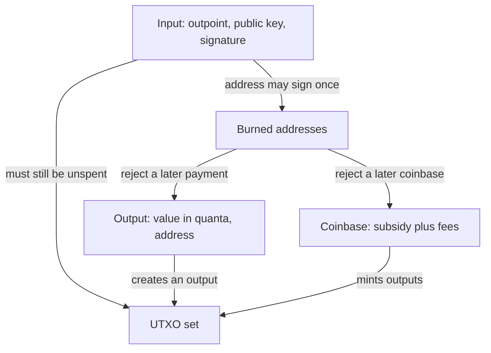
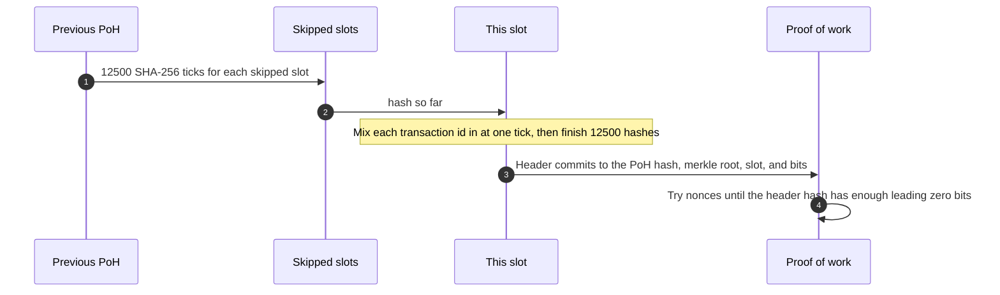
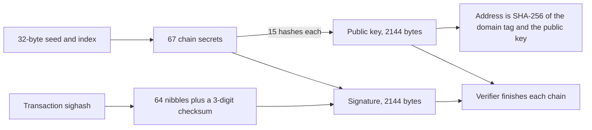
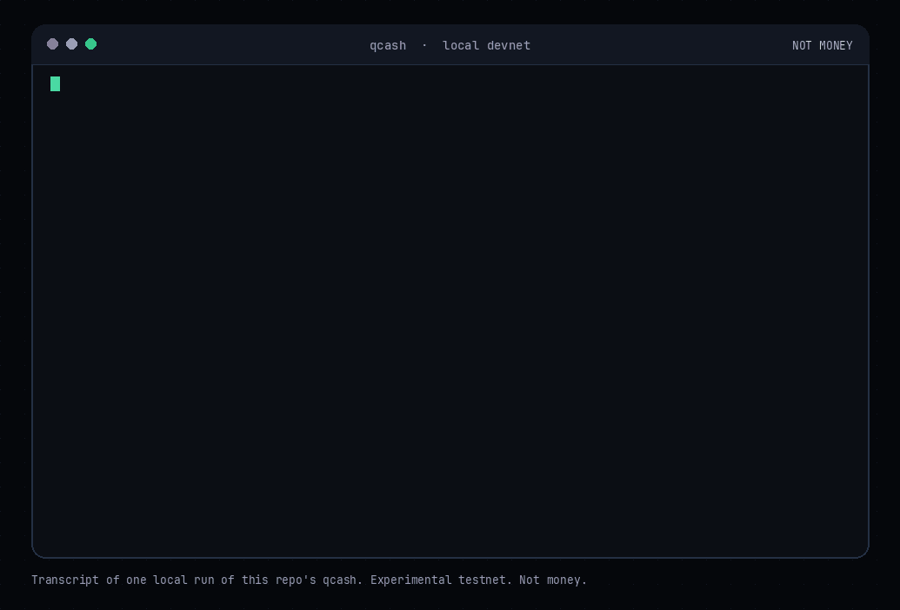

<p align="center">
  
</p>

<p align="center">
  <a href="https://quantumcash.network"></a>
  <a href="https://go.dev/"></a>
  <a href="https://github.com/nostalgicgarethdev/Quantum-Cash/actions/workflows/test.yml"></a>
  <a href="LICENSE"></a>
  <a href="docs/limitations.md"></a>
</p>

<p align="center"><strong>A small Go devnet that keeps a Bitcoin-style UTXO ledger, orders transactions with a proof-of-history clock, and signs every spend with hash-based one-time signatures.</strong></p>

## Official token

The official **$QCash** token is on Solana. It was created on pump.fun by the project wallet.

```
HHxEZmWhzCcHVr6U8AwQTxr2iHGzYSZGn3qYxJBApump
```

- [pump.fun](https://pump.fun/coin/HHxEZmWhzCcHVr6U8AwQTxr2iHGzYSZGn3qYxJBApump)
- [DexScreener](https://dexscreener.com/solana/7HHxEZmWhzCcHVr6U8AwQTxr2iHGzYSZGn3qYxJBApump)

QCASH mined by `qcash node` has no value and is separate from the $QCash Solana token. The node does not issue, bridge, or redeem that mint. The software is experimental and has not been audited.

QuantumCash (written **$QCash**, ticker **QCASH**) is a readable chain you run on your own computer. It borrows three ideas and implements them in a few Go packages. It does not contain Bitcoin Core or a Solana validator, and it does not speak to either network.

| Idea | What this repo actually does |
| --- | --- |
| Bitcoin | UTXOs, a SHA-256 proof-of-work seal, a 50 QCASH subsidy that halves every 210,000 blocks, and 100,000,000 quanta in 1 QCASH |
| Solana | Time is cut into slots. Each slot is 12,500 sequential SHA-256 ticks. Transaction ids are mixed into that chain so a verifier can replay the order |
| Hash-based signatures | Every spend carries a W-OTS-style signature over SHA-256 (`w=16`, 2,144 bytes). There is no elliptic curve in the signature path |

## Features

<table>
  <tr>
    <td width="33%" valign="top"><strong>UTXO ledger</strong><br>Coins sit in unspent outputs. A spend names the outputs, reveals the public key, and proves a signature over the transaction. Inputs must cover outputs. The difference is the fee.</td>
    <td width="33%" valign="top"><strong>Proof-of-History slots</strong><br>Each block carries the hash at the end of its slot. Empty slots are ticked through. Every node re-runs the sequence. The clock in this repo is sequential and small.</td>
    <td width="33%" valign="top"><strong>One-time signatures</strong><br>A W-OTS key signs once. After that address spends, consensus burns it and refuses later payments to it, including coinbase.</td>
  </tr>
  <tr>
    <td width="33%" valign="top"><strong>Bitcoin-style subsidy</strong><br>Block 0 pays 50 QCASH plus fees. The subsidy halves every 210,000 blocks, so the cap is about 21 million QCASH. Integer shifts mean it lands slightly under that.</td>
    <td width="33%" valign="top"><strong>Local explorer</strong><br><a href="https://quantumcash.network">quantumcash.network</a> can hash a demo clock in the browser and can read a node you already started. The page does not mine and does not hold keys. Source: <a href="site/index.html"><code>site/index.html</code></a>.</td>
    <td width="33%" valign="top"><strong>Short enough to read</strong><br>The consensus rules live in <code>chain/</code> and <code>wots/</code>. The CLI is <code>cmd/qcash</code>. Dependencies are the Go standard library.</td>
  </tr>
</table>

## Parameters

| | |
| --- | --- |
| Module | `github.com/nostalgicgarethdev/Quantum-Cash` |
| Go | 1.24.4 (`go` line in `go.mod`) |
| Ticker | QCASH, written $QCash |
| Base unit | 1 QCASH = 100,000,000 quanta |
| Subsidy | 50 QCASH, halved every 210,000 blocks |
| Proof-of-History | 12,500 SHA-256 ticks per slot |
| Devnet proof-of-work | 16 leading zero bits (override with `-bits`) |
| Signature | W-OTS-style, `w=16`, 67 hash chains, 2,144-byte public key and signature |
| Default HTTP | `:8545` on every interface. Prefer `127.0.0.1:8545` |
| Tests | `go test ./...` |

## Architecture

The diagrams describe this repository. They are not diagrams of Bitcoin or Solana.

### UTXO set



A normal transaction has no coinbase. Its fee is the sum of its inputs minus the sum of its outputs. The miner may claim the fees in the coinbase, and the coinbase may not exceed `subsidy(height) + fees`.

### Proof-of-History slots



`Produce` always builds the next slot. A verifier still accepts a later slot if the skipped slots are empty and re-ticked. The header field `poh_ticks` is stored and covered by the header hash. The verifier checks the recomputed PoH hash, not that counter.

### W-OTS signing flow



The public key is hidden until the address spends. Two different signatures from one secret let an attacker narrow the hash chains. That is why the wallet derives a fresh change key, and why consensus burns the address. Details and the exact preimage are in [docs/protocol.md](docs/protocol.md). The construction is the one in `wots/wots.go`. It is not RFC 8391 WOTS+ and it is not SLH-DSA or ML-DSA.

## Quick start

You need Go 1.24 or newer. The node has no authentication. Bind it to localhost.

```bash
git clone https://github.com/nostalgicgarethdev/Quantum-Cash.git
cd Quantum-Cash
go build -o qcash ./cmd/qcash

./qcash wallet new -w alice.json
MINER=$(./qcash wallet address -w alice.json)
echo "$MINER"
./qcash node -addr 127.0.0.1:8545 -miner "$MINER"
```

`wallet new` writes an unencrypted seed and prints the first address. `wallet address` allocates another address and prints only that line, which is why the miner command uses it. Leave the node running. In a second terminal:

```bash
./qcash wallet balance -w alice.json
./qcash wallet new -w bob.json
BOB=$(./qcash wallet address -w bob.json)
./qcash wallet send "$BOB" 12.5 -w alice.json -memo gm
./qcash wallet balance -w bob.json
```

The first balance stays at zero until a block exists. The default slot interval is 2 seconds. `send` talks to `http://localhost:8545` and attaches a fee of 1,000 quanta. Amounts on the command line are QCASH, not quanta. `12.5` is an exact decimal. Other fractions can round because the CLI parses a float.

Open [quantumcash.network](https://quantumcash.network), leave the node URL on `http://localhost:8545`, and press connect. The same page is in this repo at [site/index.html](site/index.html). The chain file is `chain.json` in the working directory. Wallet files used above are gitignored. Any other `-w` path is still an unencrypted secret. Do not commit it.

`go test ./...` covers multi-node gossip, sync, reorgs and peer bans (package `p2p`), plus signing, a spend, double-spend rejection, a tampered transaction, burned-address rejection, a bad PoH hash, an inflated coinbase, reload from disk, and the first halving.

## Terminal demo



The frames replay one local run of this repository's `qcash` binary. Addresses and hashes are from that run. The QCASH is the private-devnet subsidy. Bob ends at 12.50000000 QCASH. Alice ends at 87.50000000 QCASH: change from the 50 QCASH she spent, plus the subsidy of the block that included the spend. That block's coinbase is checked before the address is burned, so it can still pay her. The 1,000-quanta fee is inside the coinbase. A later block would not pay that address.

## One-time keys

A W-OTS secret that signs two different messages leaks enough for someone else to forge. The node enforces a narrower rule: an address that has already spent is burned, a second different transaction from that address is rejected, and nobody can pay that address again.

The wallet derives key `i` from one 32-byte seed, so one backup covers every address it will ever create. Change goes to a new index. Mine to an address that has not signed. If the miner address later spends, further subsidies go to the all-zero address, which has no known key. Restart the node with a fresh `-miner` address when that happens.

If `wallet send` fails after it has signed, do not build a second transaction that spends those same outputs. A second signature under a different message is the failure W-OTS cannot tolerate, even if the first transaction never lands in a block.

## HTTP API

| Method | Path | Role |
| --- | --- | --- |
| `GET` | `/stats` | Height, tip, supply in quanta, UTXO count, mempool size, bits, PoH tick counter, cumulative work |
| `GET` | `/peers` | Connected peers: address, direction, height, work, misbehavior score |
| `GET` | `/blocks?n=20` | Newest blocks first. `n` is clamped to 1..100 |
| `GET` | `/utxos?addr=HEX` | UTXOs for the given addresses. Repeat `addr` for more than one |
| `POST` | `/tx` | Submit a transaction JSON. Returns `{"txid":"..."}` or `{"error":"..."}` |

There is no authentication, and CORS allows any origin. Request and response bodies are JSON. Supply and values are integers in quanta. Curl examples are in [docs/http-api.md](docs/http-api.md).

## Run a network (v0.2)

Since v0.2 every node joins a peer-to-peer network over TCP. It handshakes, swaps peer addresses, gossips transactions and blocks, syncs from peers, and follows the valid chain with the most work, reorganizing when a heavier branch shows up. You can run three nodes on one machine like this:

```bash
./qcash node -data n1.json -addr 127.0.0.1:8545 -listen :7001 -miner "$MINER"
./qcash node -data n2.json -addr 127.0.0.1:8546 -listen :7002 -peers 127.0.0.1:7001 -mine=false
./qcash node -data n3.json -addr 127.0.0.1:8547 -listen :7003 -peers 127.0.0.1:7002 -mine=false
curl -s localhost:8547/peers
```

Wire format, fork choice, and ban rules are in [docs/p2p.md](docs/p2p.md).

## Join the testnet

```sh
go install github.com/nostalgicgarethdev/Quantum-Cash/cmd/qcash@latest && qcash node -network testnet
```

Public seed nodes are launching soon; until then pass `-seeds host:7101`. Details in [docs/testnet.md](docs/testnet.md).

## Roadmap

- **v0.1 devnet: shipped.** UTXO ledger, PoW, PoH slots, one-time W-OTS signatures, CLI wallet
- **v0.2 peer-to-peer network: shipped.** Handshake, peer discovery, tx and block gossip, initial sync, most-work fork choice with reorgs, misbehavior bans
- **Public testnet: ready, seeds launching soon.** Separate testnet genesis, `qcash node -network testnet`, Docker and systemd seed deploys, read-only explorer API. See [docs/testnet.md](docs/testnet.md)
- **v0.3 (planned):** reusable hash-based or lattice signatures (XMSS, SLH-DSA, or ML-DSA) so an address can spend more than once
- Later: a difficulty adjustment and a slot leader schedule
- Verifying the proof-of-history chain with more than one core

## Limitations

This is an experimental devnet. Read [docs/limitations.md](docs/limitations.md) and [WHITEPAPER.md](WHITEPAPER.md) before you treat any behavior as a guarantee.

- The p2p layer (v0.2) is unauthenticated, unencrypted TCP with no NAT traversal and no public seed nodes. A reorg replays the chain from genesis, which is fine for a devnet but not for a long chain.
- Devnet proof-of-work is 16 bits by default. Anyone who can reach the process can outwork it. Tests use 8 bits.
- Devnet QCASH mined by the node has no value and is separate from the Solana $QCash token. The software is experimental and has not been audited.
- The signature code is a teaching W-OTS. It is not a standardized parameter set.
- Wallet files are plaintext JSON, mode `0600`. The HTTP API does not authenticate callers.
- Transaction ids and block hashes commit to Go's `encoding/json` output. A port to another language has to match that encoding.
- An inactive Waves token was also called Quantum Cash (QCASH). This repository is not that token. The Solana mint in [Official token](#official-token) is the project's token. Devnet balances are neither.

## Documentation

| | |
| --- | --- |
| [docs/architecture.md](docs/architecture.md) | Packages, validation order, mempool |
| [docs/protocol.md](docs/protocol.md) | Sighash, PoH, subsidy, identifiers |
| [docs/http-api.md](docs/http-api.md) | The four HTTP routes |
| [docs/wallet.md](docs/wallet.md) | Seed file, addresses, send footguns |
| [docs/devnet.md](docs/devnet.md) | Flags, chain file, explorer |
| [docs/limitations.md](docs/limitations.md) | What this software does not do |
| [WHITEPAPER.md](WHITEPAPER.md) | The short design note, version 0.1 |
| [CONTRIBUTING.md](CONTRIBUTING.md) | Tests, style, and claims |
| [SECURITY.md](SECURITY.md) | How to report a real flaw |

Brand files: [assets/logo.svg](assets/logo.svg), [assets/glyph.svg](assets/glyph.svg), [assets/banner.svg](assets/banner.svg). Site: [quantumcash.network](https://quantumcash.network).

## License

[MIT](LICENSE). Copyright (c) 2026 garethleecrypto.
