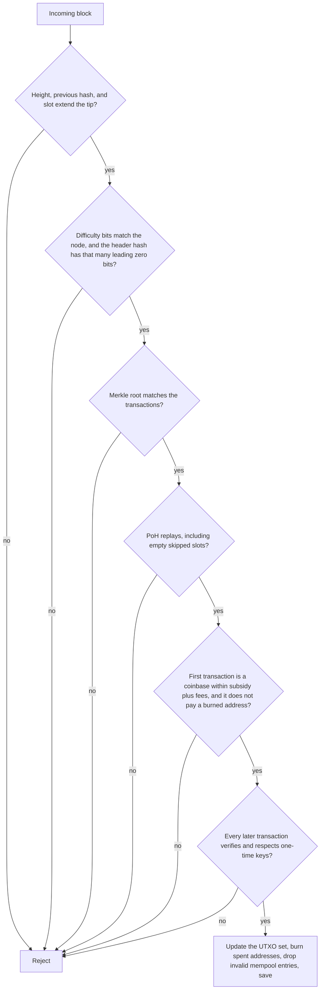
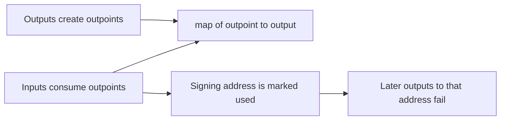

# Architecture

QuantumCash is one process. It keeps the chain in memory, writes blocks to a JSON file, and exposes four HTTP routes. Nothing in this repository dials another node.

```text
cmd/qcash     CLI: node loop, wallet, HTTP handlers
chain         UTXO set, PoH, proof-of-work, mempool, wallet helpers
wots          W-OTS-style key derivation, sign, verify, address
site          static page: a browser clock and a read-only explorer
```

## Validation order

`Chain.apply` in `chain/chain.go` accepts a block only if every step below succeeds.



The first block is the tip of an empty chain: previous hash all zeros, height 0, slot 0, PoH continuing from the genesis personalization string in `GenesisPoH`.

## UTXO set



An outpoint is a transaction id plus an output index. The id is a hash of the JSON transaction, so it commits to the memo and to the signatures. See [protocol.md](protocol.md).

## Mempool

`SubmitTx` holds transactions in a slice on the process. The slice is not written to disk. On restart the mempool is empty even when `chain.json` reloads.

A submission is checked against the UTXO set and against transactions already in the slice. The same outpoint cannot be spent twice. The same address cannot sign two different sighashes. After a block is applied, transactions that no longer verify are dropped.

## Produce

`Produce` copies the mempool under the lock, builds a coinbase to the miner address, runs PoH, then searches for a proof-of-work nonce. It releases the lock during that search and calls `AddBlock` afterwards. If the miner address is already burned, the coinbase pays the all-zero address instead.

The node goroutine in `cmd/qcash` calls `Produce` on a timer (`-interval`, default 2s).
